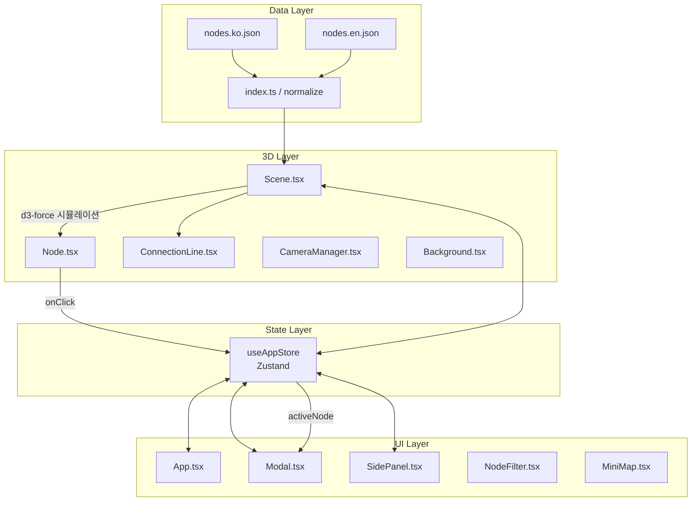
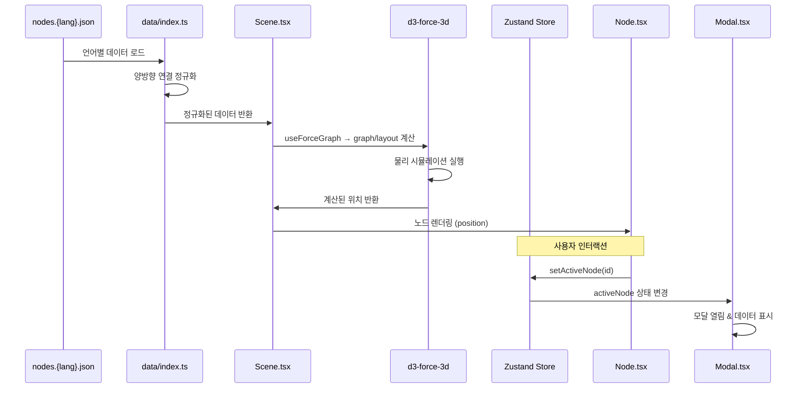
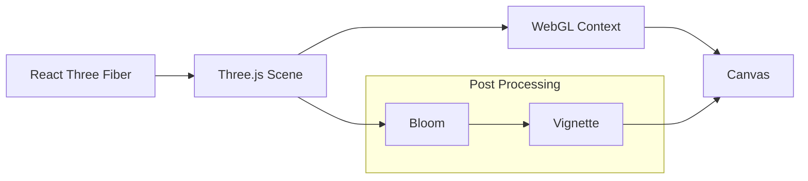

# 🏗️ System Architecture

> Neural Nexus Portfolio의 시스템 아키텍처 및 기술 구조

이 문서는 프로젝트의 내부 구조를 이해하고자 하는 개발자를 위한 기술 문서입니다.

---

## 📋 목차

1. [시스템 개요](#시스템-개요)
2. [데이터 흐름](#데이터-흐름)
3. [컴포넌트 구조](#컴포넌트-구조)
4. [상태 관리](#상태-관리)
5. [렌더링 파이프라인](#렌더링-파이프라인)

---

## 시스템 개요

### 아키텍처 다이어그램



### 기술 스택 레이어

| 레이어        | 기술                        | 역할                             |
| ------------- | --------------------------- | -------------------------------- |
| **Rendering** | Three.js, React Three Fiber | WebGL 3D 렌더링                  |
| **Physics**   | d3-force-3d                 | 노드 위치 계산 (물리 시뮬레이션) |
| **State**     | Zustand                     | 전역 상태 관리                   |
| **UI**        | React, Tailwind CSS         | 2D UI 컴포넌트                   |
| **Animation** | GSAP, CSS Transitions       | 카메라/UI 애니메이션             |
| **i18n**      | i18next                     | 다국어 지원                      |

---

## 데이터 흐름

### 전체 데이터 흐름



### 노드 클릭 플로우

```
1. 사용자가 Node 클릭
2. Node.tsx → useAppStore.setActiveNode(id)
3. useAppStore.setModalOpen(true)
4. useAppStore.setCameraTarget([x, y, z])
5. CameraManager → GSAP으로 카메라 이동
6. Modal.tsx → 해당 노드의 details 렌더링
```

### 필터링 플로우

```
1. 사용자가 NodeFilter에서 타입 토글
2. useAppStore.toggleNodeType(type)
3. visibleNodeTypes 상태 업데이트
4. Scene.tsx → 필터링된 노드만 렌더링
5. SidePanel.tsx → 검색어와 카테고리 접기 상태로 목록 탐색 (3D 표시 필터와 독립)
```

---

## 컴포넌트 구조

### 책임과 의존 방향 (2026-09-26)

- `data/index.ts`는 언어별 콘텐츠 로딩과 연결 정규화를 소유한다. `data/catalog.ts`는 검색·표시 순서·인접 노드 선택을 담당하는 순수 함수이며 React나 전역 상태에 의존하지 않는다. 사이드바와 모달이 같은 순서를 사용한다.
- `graph/visibility.ts`는 타입·카테고리 필터와 숨겨진 노드를 경유하는 연결 탐색을 담당한다. 좌표와 무관하게 캐시하므로 드래그 중 연결 구조를 다시 탐색하지 않는다.
- `graph/layout.ts`는 입력 노드의 복사본으로 3D 위치를 계산한다. `useForceGraph`는 계산 결과를 React와 위치 저장소에 연결한다. 번역만 달라질 때는 같은 그래프의 위치를 유지한다.
- `App.tsx`는 HTML 탐색을 즉시 표시하고 `Scene`을 지연 로드한다. `FeatureBoundary`가 3D 실패를 격리하고 `SceneStatus`는 실제 씬 준비 상태만 표시한다. 프로필·프로젝트는 기존 사이드바와 노드에서 열며, 그래프 위에 상시 소개 카드를 띄우지 않는다. 전체 화면을 시간으로 차단하는 로딩 연출은 사용하지 않는다.
- `Modal.tsx`는 사용자가 상세 화면을 열 때 지연 로드되어 데이터·번역·전역 상태를 조립한다. `modal/useModalController.ts`와 `useModalSwipe.ts`가 이벤트와 애니메이션 수명을 관리하고, 닫기·전환·언마운트 시 예약 작업을 정리한다.
- `modal/tabRegistry.tsx`가 탭 표시 조건과 본문 컴포넌트의 정본이다. `modal/contents/`의 컴포넌트는 필요한 데이터와 탐색 콜백만 받으며 저장소를 직접 읽지 않는다. 헤더·탭·본문은 각각의 표현 책임을 가진다.
- 연락 폼은 처음 열 때, EmailJS는 유효한 폼을 제출할 때 로드한다. 설정 누락과 폼 로드 실패는 같은 프로필 이메일 대체 UI를 사용한다. 닫힌 팝오버와 패널은 `inert`로 키보드 탐색에서 제외한다.
- 함수형 React의 합성과 타입 계약으로 책임 분리(SRP), 탭 확장(OCP), 좁은 props(ISP), 데이터·이벤트 처리와 표현의 의존 분리(DIP)를 적용한다. 상태를 공유하기 위한 클래스 상속은 사용하지 않는다.

검증은 데이터의 양 언어 연결 일치, 검색과 순회의 동일한 순서, 숨김 노드 제외, 레이아웃 입력 불변성을 자동 확인하고, 빌드·린트와 브라우저의 탭/언어/테마/키보드/모바일 확인으로 마친다.

### 디렉토리 구조

```
src/
├── data/                   # 데이터 레이어
│   ├── nodes.ko.json      # 한국어 노드 데이터
│   ├── nodes.en.json      # 영어 노드 데이터
│   ├── index.ts           # 데이터 로더 및 정규화
│   └── catalog.ts         # 검색·표시 순서·인접 노드 선택
│
├── graph/                  # 물리 배치(layout)·표시 연결(visibility) 순수 계산
├── hooks/useForceGraph.ts  # 위치 계산과 저장소 연결
│
├── locales/                # UI 번역 레이어
│   ├── ko.json            # 한국어 UI 텍스트
│   └── en.json            # 영어 UI 텍스트
│
├── components/
│   ├── canvas/             # 3D 렌더링 컴포넌트
│   │   ├── Scene.tsx      # 메인 씬 & d3-force
│   │   ├── Node.tsx       # 개별 3D 노드
│   │   ├── ConnectionLine.tsx # 연결선
│   │   ├── CameraManager.tsx  # 카메라 제어
│   │   ├── Background.tsx     # 배경 효과
│   │   └── PostProcessing.tsx # 후처리 효과
│   │
│   └── ui/                 # 2D UI 컴포넌트
│       ├── FeatureBoundary.tsx # 선택 기능의 실패 격리
│       ├── SceneStatus.tsx    # 3D 준비·실패 표시
│       ├── Modal.tsx          # 상세 모달 조립
│       ├── modal/            # 이벤트 수명·탭 등록·본문·헤더
│       ├── SidePanel.tsx      # 노드 탐색 사이드바
│       ├── NodeFilter.tsx     # 필터 바
│       ├── MiniMap.tsx        # 미니맵
│       ├── ThemeSwitcher.tsx  # 테마 전환
│       ├── LanguageSwitcher.tsx # 언어 전환
│       ├── ControlsGuide.tsx  # 조작 가이드
│       └── ContactForm.tsx    # 연락 폼
```

### Canvas 컴포넌트

#### Scene.tsx

- **역할**: 메인 3D 씬 컨테이너
- **위치 계산**: `useForceGraph`가 `graph/layout.ts`에 위임. 이 모듈이 연결 인력, 반발력, 충돌과 중앙 고정을 소유한다.
- **렌더링**: Node, ConnectionLine 컴포넌트 생성

배치는 그래프 구조가 바뀔 때 동기적으로 계산하고 시뮬레이션 타이머를 정지한다. 언어 전환은 같은 위치를 유지한다.

#### Node.tsx

- **역할**: 개별 3D 노드 (구체 + 라벨)
- **Props**: `node: NeuralNode`, `position: [x, y, z]`
- **인터랙션**:
  - 호버: 글로우 효과, 연결 노드 하이라이트
  - 클릭: 모달 열기, 카메라 이동
- **시각 효과**: 타입별 색상, 펄스 애니메이션

#### ConnectionLine.tsx

- **역할**: 두 노드 사이 연결선
- **Props**: `start`, `end`, `color`, `isHighlighted`
- **구현**: Three.js Line with BufferGeometry

#### CameraManager.tsx

- **역할**: 카메라 이동 애니메이션
- **사용 기술**: GSAP + OrbitControls
- **트리거**: `cameraTarget` 상태 변경 시

### UI 컴포넌트

#### Modal.tsx와 modal/

- **역할**: 노드 상세 정보 조립. 표현 컴포넌트와 이벤트 수명은 앞의 책임 표를 따른다.
- **탭 구조**:
  - Overview: 기본 정보, 설명
  - Features: 주요 기능
  - Tech Stack: 기술 스택 및 선정 이유
  - Code: 코드 예시
  - Challenges: 문제 해결 경험
- **특수 기능**:
  - 연결 노드 드롭다운 (빠른 탐색)
  - 외부 링크 (GitHub, Deploy, Blog, PDF)
  - 노드 간 네비게이션

#### SidePanel.tsx

- **역할**: 노드 탐색 사이드바
- **계층 구조**:
  ```
  ├── Main (메인 프로필)
  ├── Projects
  │   ├── Frontend
  │   ├── Backend
  │   └── AI-ML
  ├── Skills
  │   ├── Language
  │   ├── Framework
  │   └── Tool
  └── Lessons
  ```
- **기능**: 검색, 필터링, 노드 선택

---

## 상태 관리

### Zustand Store 구조

```typescript
interface AppState {
  // 노드 상태
  activeNode: string | null; // 선택된 노드 ID
  hoveredNode: string | null; // 호버 중인 노드 ID
  highlightedNodes: string[]; // 하이라이트된 노드들

  // 모달 상태
  isModalOpen: boolean;

  // 카메라 상태
  cameraTarget: [number, number, number] | null;
  isAnimating: boolean;

  // UI 상태
  visibleNodeTypes: NodeType[]; // 표시할 노드 타입
  visibleCategories: ProjectCategory[]; // 표시할 카테고리
  isSidePanelOpen: boolean;
  searchQuery: string;
  theme: "dark" | "light";

  // 노드 위치 (시뮬레이션 결과)
  nodePositions: Map<string, [number, number, number]>;
}
```

### 주요 액션

| 액션              | 용도        | 트리거             |
| ----------------- | ----------- | ------------------ |
| `setActiveNode`   | 노드 선택   | 노드 클릭          |
| `setHoveredNode`  | 호버 상태   | 마우스 오버        |
| `setModalOpen`    | 모달 토글   | 노드 클릭/ESC      |
| `setCameraTarget` | 카메라 이동 | 노드 선택          |
| `toggleNodeType`  | 타입 필터   | NodeFilter 클릭    |
| `toggleTheme`     | 테마 전환   | ThemeSwitcher 클릭 |

---

## 렌더링 파이프라인

### 3D 렌더링



### 프레임 워크플로우

```
1. useFrame() 호출 (매 프레임)
2. 노드·배경·연결선 애니메이션 업데이트
3. 저장된 노드 위치 사용 (물리 배치는 프레임마다 재계산하지 않음)
4. OrbitControls 업데이트
5. 씬 렌더링
6. 후처리 효과 적용
```

### 성능 최적화

| 기법                | 설명                         |
| ------------------- | ---------------------------- |
| **Instancing**      | 동일한 geometry 재사용       |
| **Frustum Culling** | 화면 밖 오브젝트 렌더링 제외 |
| **LOD**             | 거리에 따른 디테일 조절      |
| **Lazy Loading**    | 필요시 컴포넌트 로드         |

---

## 📚 관련 문서

- [README.md](../README.md) - 프로젝트 개요
- [CUSTOMIZATION.md](./CUSTOMIZATION.md) - 커스터마이징 가이드
- [COMPONENTS.md](./COMPONENTS.md) - 컴포넌트 상세 레퍼런스

### 렌더링과 자원 수명

전역 상태는 컴포넌트가 사용하는 selector로만 구독한다. 노드와 연결선은 메모이제이션하고, 좌표 변경은 해당 위치를 사용하는 렌더러만 갱신한다. 노드의 프레임별 벡터는 재사용하며, 연결선의 geometry와 shader material은 서로 다른 수명을 가진다. 직접 만든 Three.js 자원과 지연 이벤트는 소유 컴포넌트가 정리한다. 미니맵은 ID 인덱스와 고유 연결 목록을 사용한다.

CSS와 주요 3D 동작은 `prefers-reduced-motion`을 따른다. 시스템 설정 구독은 canvas의 `useReducedMotion`이 소유한다.
